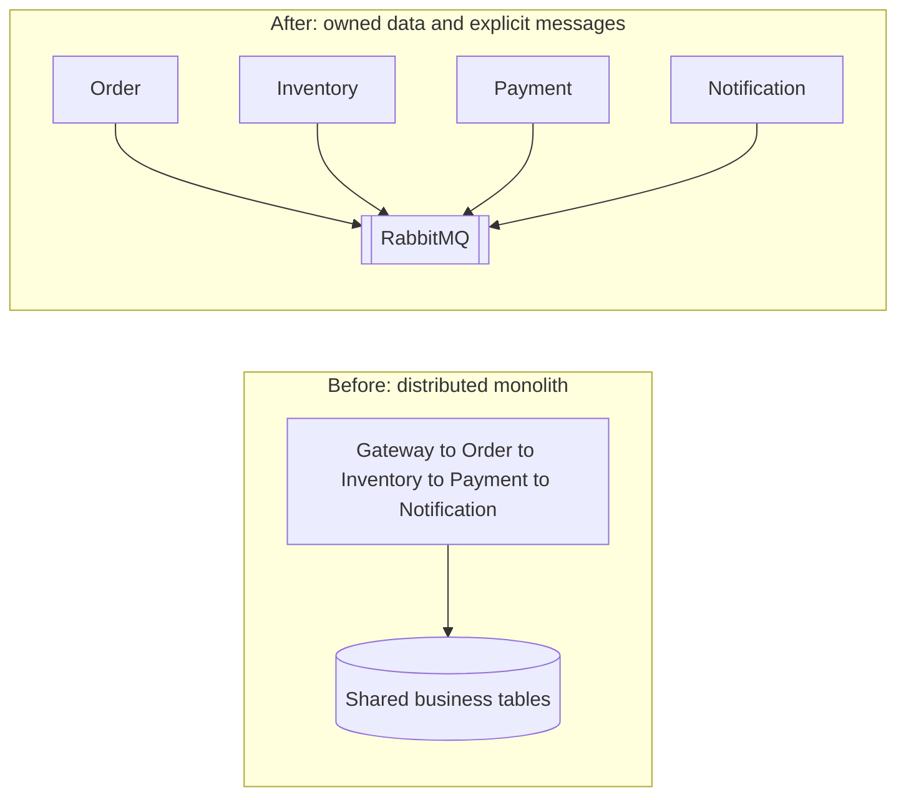

# .NET Microservices Anti-Patterns

**Microservices without independence are just a distributed monolith.**

This repository is an educational, runnable .NET 10 reference. It shows five ways independently deployed services still behave as one application, and a checkout system that avoids those mistakes with separate databases, a transactional outbox, idempotent consumers, and an orchestrated saga.

It is not a production-certified platform. Payments are simulated. Notifications are simulated. Compensation does not undo every real-world action. Exactly-once processing is not provided, and microservices are not always a better choice than a modular monolith.

## What a distributed monolith is

A distributed monolith has several deployable processes and one shared fate. Services read each other's tables, call each other in a long synchronous chain, split by technical layer, pretend a single ACID transaction covers all of them, or ship from one shared domain library. The network adds failure modes. It does not add independence.

The before-and-after pictures live in [docs/DistributedMonolith.md](docs/DistributedMonolith.md) and [docs/ImprovedArchitecture.md](docs/ImprovedArchitecture.md).



## Five mistakes

| Mistake | Harm | In this repo |
| --- | --- | --- |
| Shared database | Schema changes and locks cross service boundaries | `examples/AntiPatterns/SharedDatabase` |
| Synchronous call chains | Latency adds up, timeouts cascade, availability is the weakest hop | `examples/AntiPatterns/SynchronousChain` |
| Wrong service boundaries | Controller, repository, and validation services chatter for one business action | `examples/AntiPatterns/WrongServiceBoundaries` |
| Distributed transactions everywhere | One commit and one failure leave data that no single rollback can repair | Saga in the Order Service, [docs/SagaWorkflow.md](docs/SagaWorkflow.md) |
| Tight deployment coupling | Shared internal models force lockstep releases | `examples/AntiPatterns/DeploymentCoupling` |

The example projects are not part of the running system.

## Services

| Service | Capability | HTTP | Database |
| --- | --- | --- | --- |
| Order | Orders, lines, workflow state, orchestration | 5001 | `OrdersDb` |
| Inventory | Available and reserved quantity, reservations | 5002 | `InventoryDb` |
| Payment | Simulated authorization and idempotency | 5003 | `PaymentsDb` |
| Notification | Simulated delivery records | 5004 | `NotificationsDb` |

No service queries or updates another service's database. Docker Compose runs one SQL Server instance and four connection strings. On a shared server, use separate databases and separate logins. The design-time factories and integration tests use Windows authentication only against databases this solution creates.

Order placement is asynchronous. `GET /api/orders/availability/{productId}` is a synchronous read with a short HTTP timeout, because the caller wants the number now. That call is not on the path that places an order.

Bounded contexts and the modular-monolith decision guide: [docs/ServiceBoundaries.md](docs/ServiceBoundaries.md).

## Saga

`POST /api/orders` stores an order in `Pending` and returns **202 Accepted**. The status moves through persisted states:

`Pending` → `InventoryReserved` → `PaymentAuthorized` → `Confirmed`

Payment failure:

`InventoryReserved` → `CompensationPending` → `Failed` after inventory is released

If the release itself fails, the status is `CompensationFailed`, not `Failed`. A person has to intervene. Releasing stock does not reverse a captured charge or a sent message; this demo never captures a real charge.

Details, sequence diagrams, and the legal transition table: [docs/SagaWorkflow.md](docs/SagaWorkflow.md).

Seeded products:

| Product | Behavior |
| --- | --- |
| `WIDGET-1` | 100 available |
| `WIDGET-2` | 25 available |
| `SKU-SOLDOUT` | Reservation is rejected |
| `SKU-RELEASE-FAIL` | Reservation succeeds and release fails on purpose |

`paymentSimulation` is `authorize` or `decline`. Amounts above 10000 are declined. Card numbers are rejected. Do not put real payment data on the bus.

## Outbox, inbox, and delivery

Business changes and outbox rows commit in one local transaction. A background publisher claims a row, publishes it, and sets `PublishedAt` only after the broker accepts it. Failed publishes increment `AttemptCount` until the configured maximum, then stop. Two publishers do not publish the same locked row.

Consumers insert an inbox row in the same transaction as the local update. A duplicate event id does not repeat the side effect. A failed transaction rolls the inbox row back, so a retry can succeed. The broker is acknowledged only after that commit.

Delivery is at-least-once. A crash after publish and before the outbox update, or after commit and before `basic.ack`, produces a duplicate. Stable event ids make that duplicate recognizable. Exactly-once processing across Order, Inventory, Payment, and Notification is not claimed.

Retries are capped (`Messaging:MaxDeliveryAttempts`, default 5). The next failure dead-letters to `{queue}.dlq` through `commerce.dlx`. There is no infinite requeue.

Full topology, envelope fields, and ordering rules: [docs/MessagingAndConsistency.md](docs/MessagingAndConsistency.md).

## Contracts and deploys

Event names carry a version: `payment.authorized.v1`. A new optional JSON field can be read by a v1 consumer. Removing a required field is a new version, not a silent edit. Services do not reference each other's projects.

Tradeoffs: [docs/DeploymentTradeoffs.md](docs/DeploymentTradeoffs.md).

## Run with Docker Compose

Prerequisites used on the development machine: Docker Desktop 4.98.0, Docker Engine running, Docker CLI 29.9.2, Docker Compose 5.6.1, and WSL 2. `docker run hello-world` must succeed before the stack is useful. The Compose file expects to pull `mcr.microsoft.com/dotnet/sdk:10.0`, `mcr.microsoft.com/dotnet/aspnet:10.0`, `mcr.microsoft.com/mssql/server:2022-latest`, and, for the observability profile, `jaegertracing/all-in-one:1.62.0`. RabbitMQ uses the local image `rabbitmq:4-management`.

Docker publishes SQL Server on host port **14333** so an existing instance on 1433 is left alone. RabbitMQ uses 5672 and 15672. Change the `*_HOST_PORT` variables if those are taken. Compose does not delete unrelated volumes.

If a standalone container named `rabbitmq` already owns 5672 and 15672, stop it before Compose starts its own broker. Stopping frees the ports and keeps the container and its volume:

```powershell
docker stop rabbitmq
Copy-Item .env.example .env
docker compose up -d --build
docker compose ps
```

Start the standalone broker again, without removing it, when you want the host processes to use it:

```powershell
docker start rabbitmq
docker exec rabbitmq rabbitmq-diagnostics -q ping
```

`.env` is gitignored. `.env.example` contains placeholders only. The compose file's default password is the same development placeholder. Do not use it in production.

`docker compose --profile observability pull` completed on 6 November 2026. Local images after that pull: `rabbitmq:4-management`, `jaegertracing/all-in-one:1.62.0`, and `mcr.microsoft.com/mssql/server:2022-latest`. `docker compose up -d sqlserver` then started `microservices-antipatterns-sqlserver-1` on host port 14333. Its health check became healthy, and `SELECT 1` succeeded from the host. That container uses a new volume, `microservices-antipatterns_microservices-antipatterns-sql`. The Windows SQL Server databases were not changed.

Compose RabbitMQ was not started. The existing container named `rabbitmq` already owns 5672 and 15672, including the verified queues and the dead-letter message. Starting the Compose broker would be a second RabbitMQ. The four service images were not built. `docker compose pull` skips them, and `mcr.microsoft.com/dotnet/sdk:10.0` and `mcr.microsoft.com/dotnet/aspnet:10.0` are not local yet. The checkout results below are from the host processes and the existing broker.

`depends_on` waits for health checks, not merely for process start. SQL Server must accept a query. RabbitMQ must answer `rabbitmq-diagnostics ping`. A service is ready only when `/health/ready` can reach its database and RabbitMQ. `/health/live` only proves the process can answer.

Optional Jaeger (not part of the default stack):

```powershell
docker compose --profile observability up -d jaeger
```

Set `OTEL_EXPORTER_OTLP_ENDPOINT=http://jaeger:4317` for containers on the Compose network. Host processes use `http://localhost:4317`. The UI is http://localhost:16686. A trace counts as verified only after it has been read from that UI.

| URL | Purpose |
| --- | --- |
| http://localhost:5001/swagger | Order API |
| http://localhost:5002/swagger | Inventory API |
| http://localhost:5003/swagger | Payment API |
| http://localhost:5004/swagger | Notification API |
| http://localhost:15672 | RabbitMQ management (`guest` / `guest` by default) |
| localhost,14333 | SQL Server from the host |

OpenAPI JSON is at `/swagger/v1/swagger.json` on each service.

## Run against a local SQL Server

Docker is optional for the HTTP APIs if SQL Server is already installed. RabbitMQ is still required for the saga to leave `Pending`. Without the broker the API stays up, readiness stays unhealthy, and the outbox retries publication.

```powershell
$env:ConnectionStrings__Orders = "Server=localhost;Database=OrdersDb;Trusted_Connection=True;TrustServerCertificate=True"
$env:ConnectionStrings__Inventory = "Server=localhost;Database=InventoryDb;Trusted_Connection=True;TrustServerCertificate=True"
$env:ConnectionStrings__Payments = "Server=localhost;Database=PaymentsDb;Trusted_Connection=True;TrustServerCertificate=True"
$env:ConnectionStrings__Notifications = "Server=localhost;Database=NotificationsDb;Trusted_Connection=True;TrustServerCertificate=True"
$env:Inventory__BaseUrl = "http://localhost:5002"

dotnet run --project src/OrderService
dotnet run --project src/InventoryService
dotnet run --project src/PaymentService
dotnet run --project src/NotificationService
```

Each process applies its own EF Core migrations on startup and the Inventory Service seeds the catalog when `StockItems` is empty. That is convenient for this demo. A production system would run migrations as a separate step.

## Migrations

Local tool (version 10.0.14, same as EF Core):

```powershell
dotnet tool restore
dotnet ef migrations add <Name> --project src/OrderService --context OrdersDbContext --output-dir Data/Migrations
dotnet ef migrations add <Name> --project src/InventoryService --context InventoryDbContext --output-dir Data/Migrations
dotnet ef migrations add <Name> --project src/PaymentService --context PaymentsDbContext --output-dir Data/Migrations
dotnet ef migrations add <Name> --project src/NotificationService --context NotificationsDbContext --output-dir Data/Migrations
```

## API examples

Create an order. Repeat the same `Idempotency-Key` to get the original order back with HTTP 200.

```powershell
curl -X POST http://localhost:5001/api/orders `
  -H "Content-Type: application/json" `
  -H "Idempotency-Key: checkout-1001" `
  -H "X-Correlation-ID: checkout-1001" `
  -d "{\"customerId\":\"customer-1\",\"paymentSimulation\":\"authorize\",\"currency\":\"USD\",\"lines\":[{\"productId\":\"WIDGET-1\",\"quantity\":1,\"unitPrice\":12.50}]}"
```

Poll until the status is `Confirmed`, `Failed`, or `CompensationFailed`:

```powershell
curl http://localhost:5001/api/orders/{id}/status
```

Immediate inventory and payment calls, which do not drive the saga:

```powershell
curl http://localhost:5002/api/inventory/WIDGET-1
curl -X POST http://localhost:5002/api/inventory/reservations -H "Content-Type: application/json" -d "{\"orderId\":\"<guid>\",\"lines\":[{\"productId\":\"WIDGET-1\",\"quantity\":1}]}"
curl -X POST http://localhost:5002/api/inventory/reservations/{id}/release
curl -X POST http://localhost:5003/api/payments/authorize -H "Content-Type: application/json" -H "Idempotency-Key: pay-1001" -d "{\"orderId\":\"<guid>\",\"amount\":12.50,\"simulation\":\"authorize\"}"
curl http://localhost:5004/api/notifications
```

Use a different order id for the direct payment API than the one the saga is authorizing. Both paths share `Payments.OrderId`. The saga will not emit a second result if a row already exists.

Decline the saga payment with `"paymentSimulation":"decline"`. Reject stock with `SKU-SOLDOUT`. Force a compensation failure with `SKU-RELEASE-FAIL`.

`ReleaseFailure:Enabled` defaults to true in Inventory `appsettings.json`. While it is true, a reservation that contains `SKU-RELEASE-FAIL` stays active and the release returns the simulated failure. Set `ReleaseFailure__Enabled=false` and restart Inventory Service when an operator is ready to release that reservation. That is the same failure check, turned off. It is not a second failure mode.

Retry compensation only from `CompensationFailed`. The call writes one new `inventory.release.v1` through the Order outbox. The new message gets a new event id. Its correlation id is the order id, and its causation id is the `InventoryReleaseFailed` event that left the order stuck. The history row `CompensationFailed` → `CompensationPending` uses trigger `CompensationRetry` and the same event id as that outbox message. A second call while the order is `CompensationPending` or any other status does not write another release command. A concurrent duplicate loses on the order row version and rolls back.

```powershell
curl.exe -X POST http://localhost:5001/api/orders/{id}/compensation/retry
```

HTTP 202 means the retry was stored. The order is recovered only after it is persisted as `Failed` and the reservation is `Released`.

## Tests

```powershell
dotnet test DotNet-Microservices-AntiPatterns.sln -c Release
```

Unit tests cover workflow transitions, stock rules, the payment simulator, the synchronous-chain failure mode, contract evolution, and project references.

Integration tests that need SQL Server use `OrdersDb_It`, `InventoryDb_It`, `PaymentsDb_It`, and `NotificationsDb_It` on the server in `COMMERCE_SQL_MASTER` (default: `localhost` with Windows authentication). They are skipped when that server cannot be opened. They do not drop unrelated databases.

The RabbitMQ test publishes `order.placed.v1` and reads it back from `q.notification.orders`. It is skipped when port 5672 is closed. Stop the Notification Service before this test. A running consumer will take the message and the assertion will fail. The SQL saga tests run the real handlers, outbox rows, and inbox transactions through an in-memory stand-in for the broker. Those tests prove the local transactions and the workflow. The single broker test proves one durable publish and read-back.

EF Core InMemory is not used.

Release run on 6 November 2026, with local SQL Server and RabbitMQ listening, and with the four service processes stopped:

| Project | Passed | Failed | Skipped |
| --- | ---: | ---: | ---: |
| OrderService.Tests | 12 | 0 | 0 |
| InventoryService.Tests | 5 | 0 | 0 |
| PaymentService.Tests | 4 | 0 | 0 |
| AntiPattern.Tests | 7 | 0 | 0 |
| IntegrationTests | 22 | 0 | 0 |
| **Total** | **50** | **0** | **0** |

An earlier run, before RabbitMQ was installed, was 49 passed and 1 skipped. The skipped test was the broker read-back. A 6 November run was 50 passed, 0 failed, 0 skipped.

After the compensation retry was added, on 7 November 2026:

`dotnet build DotNet-Microservices-AntiPatterns.sln -c Release` succeeded with 0 warnings and 0 errors.

`dotnet test DotNet-Microservices-AntiPatterns.sln -c Release --no-build`:

| Project | Passed | Failed | Skipped |
| --- | ---: | ---: | ---: |
| OrderService.Tests | 21 | 0 | 0 |
| InventoryService.Tests | 5 | 0 | 0 |
| PaymentService.Tests | 4 | 0 | 0 |
| AntiPattern.Tests | 7 | 0 | 0 |
| IntegrationTests | 27 | 0 | 0 |
| **Total** | **64** | **0** | **0** |

The new tests cover retry from `CompensationFailed`, rejection from other states, a second retry while compensation is pending, one release command when two retry requests race, rollback of a retry that does not commit, release of `SKU-RELEASE-FAIL` after the simulation is disabled, a duplicate `inventory.released.v1`, an `inventory.released.v1` that arrives before compensation starts, and two outbox dispatchers claiming one row. The SQL saga tests still use the in-memory broker stand-in except for the single RabbitMQ read-back test. Live results below were not produced by changing test expectations.

## Observability

- JSON console logs with correlation and trace scopes.
- `X-Correlation-ID` on the way in and out.
- OpenTelemetry traces for ASP.NET Core, `HttpClient`, and `Commerce.Messaging`.
- Metrics for publish retries, consumer retries, processed messages, and dead letters.
- Console trace export when `OpenTelemetry:UseConsoleExporter` is true (Development).
- OTLP export when `OpenTelemetry:OtlpEndpoint` is set.

Do not treat a configured exporter as proof that a trace was collected. Read the console or the trace UI.

## Topology

Exchanges are durable topic exchanges: `commerce.events` and `commerce.dlx`. Each queue has a matching `{queue}.dlq` bound to `commerce.dlx`.

| Queue | Routing keys |
| --- | --- |
| `q.inventory.commands` | `inventory.reserve.v1`, `inventory.release.v1` |
| `q.payment.commands` | `payment.authorize.v1` |
| `q.order.workflow` | `inventory.reserved.v1`, `inventory.reservation-failed.v1`, `inventory.released.v1`, `inventory.release-failed.v1`, `payment.authorized.v1`, `payment.failed.v1` |
| `q.notification.orders` | `order.placed.v1`, `order.confirmed.v1`, `order.failed.v1`, `order.compensation-failed.v1` |

Order creation writes `order.placed.v1` and `inventory.reserve.v1` in the same SQL transaction. Inventory does not consume `order.placed.v1`. The management UI is http://localhost:15672. The image default is `guest` / `guest`. Those are demo credentials.

## Live verification (6 November 2026)

Host processes, Windows authentication, existing databases `OrdersDb`, `InventoryDb`, `PaymentsDb`, and `NotificationsDb`. Broker: container `rabbitmq`, image `rabbitmq:4-management`, AMQP `localhost:5672`, management UI above. `rabbitmq-diagnostics ping` succeeded. All four `/health/live` and `/health/ready` responses were HTTP 200 while SQL Server and RabbitMQ were up. Each work queue had one consumer. Dead-letter queues were empty before the poison-message test.

Startup migrations created the schemas on first launch. Existing rows were left in place. `WIDGET-1` was already below the seed quantity because an earlier direct reservation and an earlier saga had reserved stock. Quantities below are the values read during this run.

**Successful checkout.** `Idempotency-Key: live-success-1`, `X-Correlation-ID: live-success-corr`, `paymentSimulation: authorize`, one `WIDGET-1` at unit price 19.

- HTTP 202, order `4efdf769-af57-46cd-99ac-7c5d557dad1d`, initial status `Pending`.
- Final status `Confirmed`. Reservation `ef72b69b-708e-41d7-9b45-5e6c824480cb`. Payment `54b936bc-bd06-4c9d-8f05-e124d43c775b`, status `Authorized`.
- History: `Pending` → `InventoryReserved` → `PaymentAuthorized` → `Confirmed`.
- Outbox rows for that correlation id all had `PublishedAt` set and `AttemptCount` 0: `order.placed.v1`, `inventory.reserve.v1`, `payment.authorize.v1`, `order.confirmed.v1`.
- Notifications `OrderReceived` and `OrderConfirmed`, channel `SimulatedEmail`, status `Delivered`.
- `WIDGET-1` after this order: 97 available, 3 reserved.

**Payment decline and compensation.** `Idempotency-Key: live-decline-1`, correlation `live-decline-corr`, `WIDGET-2`, `paymentSimulation: decline`. `WIDGET-2` was 25 available and 0 reserved before the call.

- HTTP 202, order `2f88b845-81c2-4f48-b10a-afd159884b6a`.
- Final status `Failed`. Reason: `The simulated payment was declined.`
- Path: `InventoryReserved` → `CompensationPending` → `Failed`.
- `WIDGET-2` after compensation: 25 available, 0 reserved. Reservation status `Released`. Payment status `Declined`.
- Notifications `OrderReceived` and `OrderFailed`.

**Release failure.** `Idempotency-Key: live-comp-fail-1`, correlation `live-comp-corr`, product `SKU-RELEASE-FAIL`.

- HTTP 202, order `18db9f0c-451a-488a-9423-b8a4188a8af7`.
- Final status `CompensationFailed`. Reason: `Simulated compensation failure for SKU-RELEASE-FAIL. The reservation is still active and needs manual intervention.`
- Stock became 9 available and 1 reserved. Reservation `d6d79b22-eb39-4ffd-9cbd-df7a9216464a` stayed `Active`.
- While `ReleaseFailure:Enabled` is true, both the HTTP release and `inventory.release.v1` keep failing for this product. `POST /api/inventory/reservations/d6d79b22-eb39-4ffd-9cbd-df7a9216464a/release` returned HTTP 409. A republished release command, event `ddcc2f1d-4206-49fd-9f28-75e8e5955f8a`, produced a second `inventory.release-failed.v1` and left the order `CompensationFailed`. Stock stayed 9 available and 1 reserved.
- Recovery is the retry operation below. It does not edit inventory rows from the Order Service, and it does not succeed while the simulated failure is still enabled.

**Compensation recovery, 7 November 2026.** Inventory was restarted with `ReleaseFailure__Enabled=false`. No order, reservation, or stock row was edited by hand. `POST /api/orders/18db9f0c-451a-488a-9423-b8a4188a8af7/compensation/retry` returned HTTP 202 and moved the order to `CompensationPending` at `2026-11-07T10:47:39.0427042+00:00`.

- New outbox command `inventory.release.v1`, event `4dad8667-800a-42ba-b23a-1fd62b130e05`, causation `77d0d8b5-53a4-4c95-ad3e-6ae9c67eb505` (the earlier `InventoryReleaseFailed` event), correlation the order id. `PublishedAt` was set.
- History: `CompensationFailed` → `CompensationPending`, trigger `CompensationRetry`, event id `4dad8667-800a-42ba-b23a-1fd62b130e05`.
- Inventory published `inventory.released.v1` event `1776460d-e78a-4ba1-ba9a-8d0800345d09`. Order consumed it and moved `CompensationPending` → `Failed` at `2026-11-07T10:47:43.7795279+00:00`, trigger `InventoryReleased`.
- Reservation `d6d79b22-eb39-4ffd-9cbd-df7a9216464a` is `Released` at `2026-11-07T10:47:41.4505069Z`. `SKU-RELEASE-FAIL` is 10 available and 0 reserved.
- `order.failed.v1` was published. Notification template `OrderFailed` is `Delivered`.
- A second `POST` to the same retry URL returned HTTP 409: `Compensation retry requires CompensationFailed and a reservation. The order is Failed.`
- Inventory Service was then restarted without the override, so `ReleaseFailure:Enabled` is true again. The recovered reservation stayed released.

**Outbox, inbox, and duplicates.** Republishing the stored `inventory.reserve.v1` payload for the confirmed order through `commerce.events` returned `routed: true`. The order stayed `Confirmed`, its `UpdatedAt` did not change, `WIDGET-1` stayed 97/3, the reservation count stayed 1, and the inventory inbox row count stayed 6. The unique inbox key is `(EventId, ConsumerName)`. The consumer acknowledges only after the local transaction commits. The publisher sets `PublishedAt` only after the broker accepts the message. Delivery is at-least-once.

Two `OutboxDispatcher` instances were run against one eligible row in `OrdersDb` while the Order Service publisher was stopped. Row `f686b7b8-24e7-4b9d-8f73-f2fea9cc1c8b` was claimed by the first dispatcher (`locked=True`). That dispatcher published it once. The second dispatcher published 0 copies (`firstPublished=1`, `secondPublished=0`, `brokerPublishes=1`, `secondBrokerPublishes=0`). `PublishedAt` was `2026-11-07T10:46:12.8466219+00:00`. The probe row was then deleted, and the temporary locks placed on other unpublished rows were cleared. A separate run of `Two_dispatchers_cannot_publish_the_same_outbox_row` against `OrdersDb_It` reported the same shape for row `e8d7dd75-11ec-4120-b292-6fe55b21e422`: first dispatcher 1, second dispatcher 0. Those were two dispatchers in one process, on two `DbContext` instances, not two operating-system processes.

**Broker outage and dead letter.** A `inventory.reserved.v1` message for missing order `3520da38-1035-4a30-9045-098d5a3ab6aa` (event `ad3e1e3d-674b-4f5c-bdaa-71d9757bba01`) was published to `commerce.events`. The Order consumer throws because that order does not exist. The inbox insert is in the same transaction as the handler, so the exception rolls the inbox row back. RabbitMQ redelivers. `DeliveryPolicy` republishes while `attempt + 1` is below `Messaging:MaxDeliveryAttempts` (5, counting from `x-attempt` 0). The next failure nacks with requeue false. The queue dead-letters to `commerce.dlx` with routing key `q.order.workflow.dlq`. The inbox stayed empty for that event id. On 7 November the queue still held that 1 message. It was not acked or purged.

Leave the message until a person has read it. Replaying it does not repair anything: the order id was never stored, so the handler throws again and the message returns to the dead-letter queue. Creating a fake order so the replay can be applied would record a reservation the inventory service did not make. Safe handling is to copy the payload into the incident log and keep the message, or move it to an operator parking queue. Do not republish it as a new `inventory.reserved.v1`.

`docker stop rabbitmq` left Order `/health/live` at 200 and `/health/ready` at 503. `POST /api/orders` with `Idempotency-Key: live-retry-1` and correlation `live-retry-corr` returned 202 for order `c21a0b0f-50c7-4a4d-bb1c-bcd13919a897`, status `Pending`. Both outbox rows were unpublished with `AttemptCount` 1 and `LastError` `None of the specified endpoints were reachable`. After `docker start rabbitmq`, the same order reached `Confirmed` at `2026-11-06T18:16:04.7699598+00:00`. Those two rows were then published with `AttemptCount` 5, and `payment.authorize.v1` and `order.confirmed.v1` were published with `AttemptCount` 0. Readiness returned 200 and `rabbitmq-diagnostics ping` succeeded.

**Distributed trace.** After the Jaeger image was local, a container named `jaeger` was started with `COLLECTOR_OTLP_ENABLED=true` and host ports 16686 and 4317, matching the observability profile. It was started with `docker run` while `docker compose pull` was still transferring SQL Server, so it is not a Compose-created container. http://localhost:16686 returned HTTP 200. The four host processes were restarted with `OpenTelemetry__OtlpEndpoint=http://localhost:4317`.

`Idempotency-Key: live-trace-1`, correlation `live-trace-corr`, one `WIDGET-2` at unit price 8, `paymentSimulation: authorize` returned HTTP 202 for order `25e6c211-ffba-4486-8173-34dcb5edadbf` and reached `Confirmed`. Jaeger trace `0489aa73caeacb7f612d7686797a309c` contains spans from `order-service`, `inventory-service`, `payment-service`, and `notification-service`, including `POST api/orders`, `consume inventory.reserve.v1`, `consume inventory.reserved.v1`, `consume payment.authorize.v1`, `consume payment.authorized.v1`, `consume order.placed.v1`, and `consume order.confirmed.v1`. After that order, `WIDGET-2` was 24 available and 1 reserved. `SKU-RELEASE-FAIL` was still 9 available and 1 reserved.

**Still unverified on this machine.** The four Compose service containers. Compose RabbitMQ was not created, so the existing broker and its dead-letter message stay in place. Two operating-system processes racing the same outbox row; the live and `OrdersDb_It` evidence used two dispatchers in one process. `SKU-SOLDOUT` was not repeated in this live pass; the reservation-failed path is covered by the SQL saga integration test.

## Production tradeoffs and operational complexity

You now operate four deployables, four schemas, a broker, dead-letter queues, an outbox lag, and orders that can sit in `CompensationFailed`. Dashboard the unpublished outbox, the dead-letter queues, and orders that are not terminal. Cap retries. Give people a way to repair a reservation that could not be released. Add TLS in front of the APIs. Restrict Swagger. Replace the startup migrator with a migration job. Replace simulated payment and email with real providers only behind ports that still publish the same integration events.

Known limits of this demo:

- The client sends `unitPrice`. That is not a production price source.
- Reservations do not expire. There is no sweeper.
- `SKU-RELEASE-FAIL` still fails release while `ReleaseFailure:Enabled` is true. The retry API sends another `inventory.release.v1`; it does not bypass that check. Turn the setting off before retrying a reservation that hit the simulation.
- A retry is accepted only from `CompensationFailed`. It is not an automatic loop.
- `MigrateAsync` on startup is for this demo. Run migrations as a separate job in production.
- Payment and notification are simulations. A declined payment here never captured funds.
- Compensation cannot reverse a captured external payment or a notification that was already delivered.
- Consumers and the outbox provide at-least-once delivery. They do not provide exactly-once delivery.

A modular monolith is the better system when one team ships checkout together and has not hit a scaling or isolation limit. Keep the bounded contexts. Skip the network until independence is a requirement you are willing to pay for.

## Stack

.NET SDK 10.0.401, ASP.NET Core, EF Core 10.0.14, SQL Server, RabbitMQ.Client 7.2.2, OpenTelemetry 1.20.1, Swashbuckle 10.3.1, xUnit 2.9.3. Package versions are centralized in `Directory.Packages.props`.
