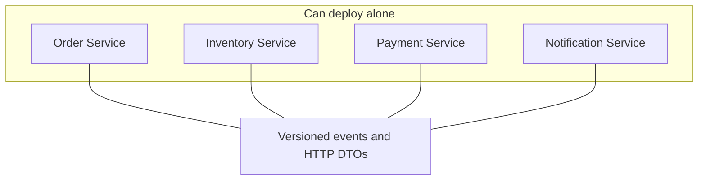

# Deployment tradeoffs

## The coupled release

`examples/AntiPatterns/DeploymentCoupling` contains `SharedOrderEntity`, an internal shape with an inventory navigation. If Order, Inventory, and Payment all reference that type, a renamed property or a new required field forces a lockstep deploy. The binary coupling recreates the monolith's release train.

## Independent deployables

Rules that keep a deploy from becoming a group deploy:

- Do not share domain entities across service projects. The solution test fails if one service references another.
- Integration events are versioned in the routing key: `inventory.reserved.v1`.
- A consumer of v1 keeps its queue binding. A v2 event is a new routing key. Old consumers do not have to move on the same day.
- Adding an optional JSON field is compatible. `ContractCompatibility` deserializes a payload that contains `loyaltyPoints` into `OrderConfirmedV1`.
- Removing or renaming `orderId`, `totalAmount`, or `currency` is a breaking change. The compatibility check lists the missing fields. Publish that as a new version, and keep publishing v1 until every consumer has moved.
- HTTP changes follow the same idea: add response fields, do not rename required request fields in place.

`SharedContracts` is allowed to hold stable technical pieces: the envelope, outbox and inbox tables, the RabbitMQ connection, and the event DTOs. If a business rule appears there, it has become a shared domain model and the services are coupled again.

## What you take on by splitting deploys

Independent deployment is real only if a new Order Service can start against the events the current Inventory Service already publishes. That requires:

- Backward-compatible contracts.
- Database migrations that expand first and contract later.
- Health checks that tell an orchestrator when a process is actually ready.
- Someone who can read a `CompensationFailed` order, because the platform will not always repair itself.

Four pipelines, four databases, a broker, dead-letter queues, and duplicate messages are the cost of the isolation. Pay it when the isolation is worth it. Otherwise keep the boundaries and ship one modular monolith.
