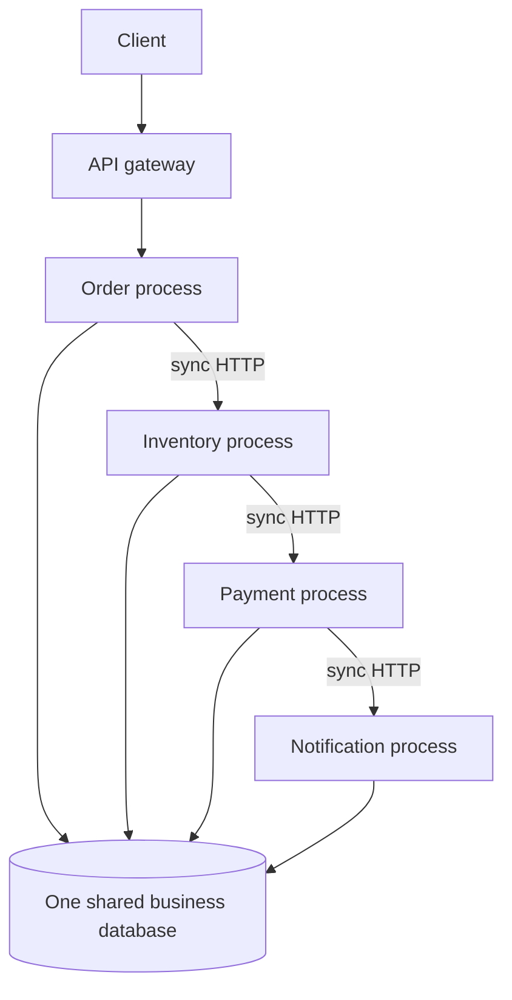

# The distributed monolith

A distributed monolith is a system that is deployed as several processes but still changes, fails, and releases as one application. The network is there. The independence is not.

The phrase to keep is: **microservices without independence are just a distributed monolith.**

## Before

This picture has separate deployables and still behaves like one system:

- Order code queries inventory tables.
- Payment code updates order rows.
- A column rename in one service breaks the others at runtime.
- The place-order request waits on every downstream service.
- One slow or unavailable service fails the whole call.
- People assume one ACID transaction covers all of those databases.
- A "shared" contract library exposes internal entities, so services have to ship together.

## The five mistakes in this repository

| # | Mistake | Where the problem is shown | What the runnable system does instead |
| --- | --- | --- | --- |
| 1 | Shared database | `examples/AntiPatterns/SharedDatabase` | Each service has its own DbContext and database |
| 2 | Synchronous call chain | `examples/AntiPatterns/SynchronousChain` | Commands and facts move through RabbitMQ; HTTP stays for immediate reads |
| 3 | Technical service boundaries | `examples/AntiPatterns/WrongServiceBoundaries` | Order, inventory, payment, and notification are business capabilities |
| 4 | Distributed transactions everywhere | Documented in `docs/SagaWorkflow.md` | A local transaction plus an orchestrated saga with compensation |
| 5 | Lockstep deployment | `examples/AntiPatterns/DeploymentCoupling` | Versioned integration events and consumer-side compatibility checks |

The educational projects are not referenced by the four services and are not started by Docker Compose.

## Why the shared database feels convenient

Joining `Orders` to `Inventory` answers a question in one query. It also means:

- Schema ownership is unclear.
- A migration in inventory is a production change for order and payment.
- You cannot restore or scale one service's data on its own.
- A lock or long transaction in one area blocks unrelated work.
- Teams stop being able to deploy independently, which was the reason for splitting the process.

## Operational and business impact

- A checkout outage follows a notification or inventory deploy.
- Latency is the sum of every hop, and timeouts become an incident multiplier.
- Partial commits leave an order paid in one database and unreserved in another, with no record of what to undo.
- Releases turn into a calendar negotiation. The architecture diagram says "microservices"; the release plan says "big bang."
