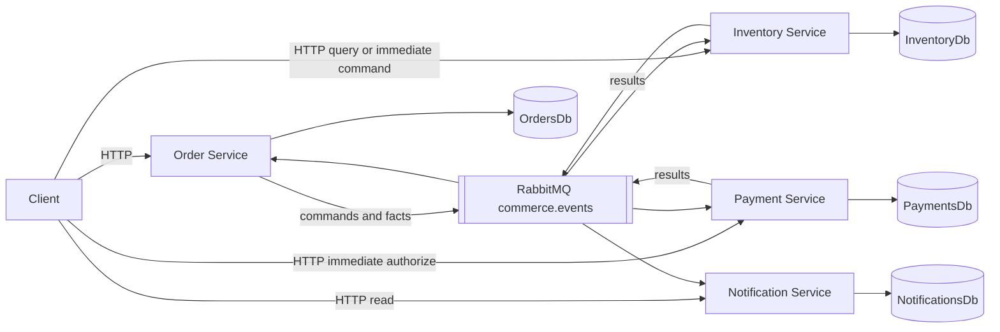
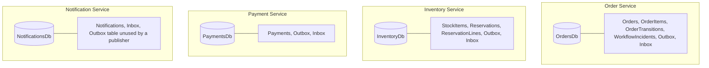

# Improved architecture

The runnable system is four ASP.NET Core services. Each one owns its business data. They cooperate with explicit HTTP contracts and versioned integration events. The Order Service orchestrates the checkout saga.

## Database ownership

Shared SQL Server infrastructure is acceptable. Shared business tables are not. Nothing in the Order Service project names `InventoryDb`, `PaymentsDb`, or `NotificationsDb`. Architectural tests scan the service projects and the EF models.

There are no EF navigation properties from an order to a stock row. A service that needs another service's data either calls that service's API or keeps its own copy from an integration event.

## What is synchronous, and what is not

| Need an answer now? | Mechanism | Example |
| --- | --- | --- |
| Yes | HTTP, short timeout | `GET /api/inventory/{productId}` and Order Service `GET /api/orders/availability/{productId}` |
| No, the workflow can finish later | RabbitMQ command or fact | Reserve stock, authorize a simulated payment, record a notification |

`POST /api/orders` writes the order and the outbox in OrdersDb and returns **202 Accepted** with status `Pending`. HTTP 202 means the order was stored. It does not mean stock was reserved or payment was authorized. Clients poll `GET /api/orders/{id}/status`.

The availability call is allowed to fail without preventing order placement. Placement does not call inventory over HTTP. If it did, checkout would again depend on inventory being up at the moment of the click, which is mistake 2.

## Consistency

After `POST /api/orders`, the order exists and the rest of the platform has not caught up yet. That is eventual consistency. The order status is the source of truth for how far the saga got. Inventory quantities and payment rows catch up when their consumers commit.

Duplicating a product id and quantity onto the order is deliberate. The order must not read the inventory database to remember what the customer asked for. Price on the order is the price captured at creation. This demo accepts that price from the client so the write path stays local. A production catalog would own price. Copy it into the order at the edge, or from a pricing API that is allowed to be synchronous because the user is waiting for a quote, not from a chain of writes.

## API versus events

Use an API when the caller must branch on the result before continuing, or when a person is waiting for a read. Use an event or command when the next step can happen later and the sender should not fall over because the receiver is restarting.

Events add brokers, duplicates, retries, and delayed visibility. They are the wrong tool for "what is the stock level right now?" They are the right tool for "reserve this stock, then authorize payment, then tell the customer."
