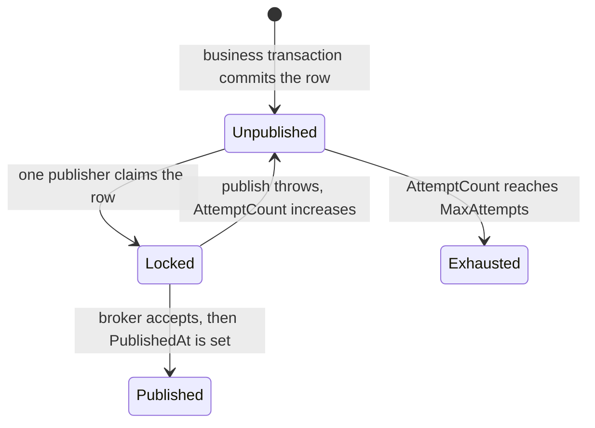
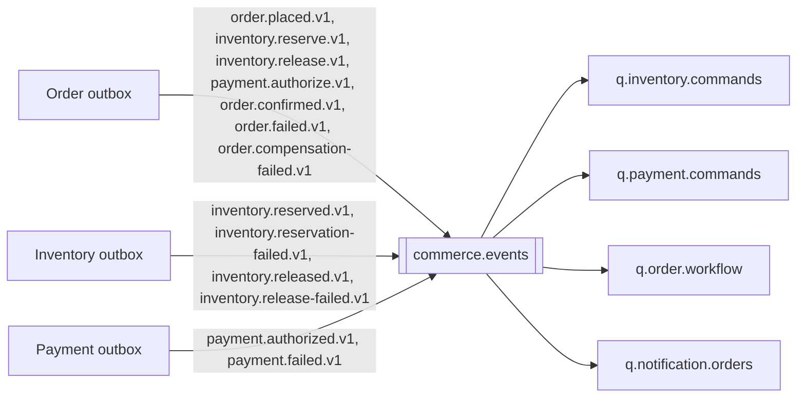

# Messaging and consistency

## The dual write

If a service updates its database and then publishes to RabbitMQ, a crash in between leaves a committed business change and no message. If it publishes and then commits, a crash leaves a message for a change that rolled back.

The transactional outbox puts the message in the same database transaction as the business change. A background publisher sends unpublished rows and sets `PublishedAt` only after the broker accepts the publish.

A publisher can crash after RabbitMQ accepts the message and before `PublishedAt` is saved. The lock expires, another publisher sends the same event id again. Consumers must tolerate that duplicate. This repository does not implement exactly-once delivery.

Two publishers claim a row with a conditional update on `LockToken` and `LockedUntil`. The loser updates zero rows and moves on. Shutdown cancels the publisher loop. It does not mark a row published if the publish call was cancelled.

After `Outbox:MaxAttempts` (10 by default) the row stays unpublished and is no longer selected. Reset `AttemptCount` to replay it. That path is separate from the consumer dead-letter queues.

## Inbox

Each consumer writes `InboxMessages` with a unique `(EventId, ConsumerName)` key in the same transaction as the local business change.

1. Insert the inbox row.
2. If the key already exists, roll back and acknowledge the delivery. The business work does not run.
3. Apply the local change and any new outbox rows.
4. Commit.
5. Acknowledge the RabbitMQ delivery only after that commit.

If the business transaction throws, the inbox insert rolls back with it. The broker redelivers. A failed attempt is not a permanent "already processed" mark.

At-least-once delivery means the handler can see a message more than once. The inbox makes the local transaction idempotent. It does not make the whole distributed system exactly-once. A crash after commit and before `basic.ack` causes a redelivery, which the inbox absorbs. A crash after publish and before the outbox mark causes a second publish, which the next inbox absorbs. Those are two different duplicates, and both are expected.

## RabbitMQ topology

| Exchange | Type | Durable |
| --- | --- | --- |
| `commerce.events` | topic | yes |
| `commerce.dlx` | topic | yes |

Routing keys are the event names.

| Queue | Bindings |
| --- | --- |
| `q.inventory.commands` | `inventory.reserve.v1`, `inventory.release.v1` |
| `q.payment.commands` | `payment.authorize.v1` |
| `q.order.workflow` | `inventory.reserved.v1`, `inventory.reservation-failed.v1`, `inventory.released.v1`, `inventory.release-failed.v1`, `payment.authorized.v1`, `payment.failed.v1` |
| `q.notification.orders` | `order.placed.v1`, `order.confirmed.v1`, `order.failed.v1`, `order.compensation-failed.v1` |

Each queue has a durable dead-letter queue named `{queue}.dlq`, bound to `commerce.dlx`. Queues are durable. Messages are persistent. Each service declares the topology on connect so a consumer can start before a publisher.

## Event flow

## Retries and poison messages

Consumers prefetch one message and use one channel callback at a time so acknowledgements stay on a single thread.

`Messaging:MaxDeliveryAttempts` defaults to 5. The `x-attempt` header starts at 0.

- Success: `basic.ack`.
- Failure below the limit: republish the same body and event id with `x-attempt + 1`, then ack the original. There is no infinite requeue loop.
- Failure at the limit: `basic.nack` with `requeue: false`. The queue's dead-letter exchange receives it.

Counters on the `Commerce.Messaging` meter:

- `commerce.outbox.publish.retries`
- `commerce.consumer.processed`
- `commerce.consumer.retries`
- `commerce.consumer.dead_letters`

Dead-letter depth is visible in the RabbitMQ management UI. This process does not scrape queue depth itself.

## Ordering

Classic queues preserve order only while one consumer processes a queue without republishing. Retries break that. The saga ignores events that do not match the persisted status, so a late or reordered result does not confirm an order that is still `Pending` or resurrect one that already failed.

## Message contract

The body is an envelope:

- `eventId` is stable for the life of the outbox row.
- `eventType` includes the version, for example `payment.authorized.v1`.
- `eventVersion` repeats that version as a number.
- `correlationId` is the order id.
- `causationId` is the event that caused this one, when there is one.
- `payload` is the versioned JSON document.

Consumers depend on these contracts, not on another service's entity classes. `SharedContracts` holds the event documents and the messaging primitives. It does not hold an `Order` or `StockItem` entity.

## Correlation and traces

HTTP requests accept or generate `X-Correlation-ID` and echo it on the response. Logs include that value and the trace id as structured scope fields. Outbox rows store the current `traceparent` when one exists, and the publisher copies it onto the message. The consumer starts a `Commerce.Messaging` activity with that parent.

Payment simulation values are only `authorize` or `decline`. Card numbers are rejected. Logs do not include a payment simulation secret because there is not one; do not add a card field to the outbox.
