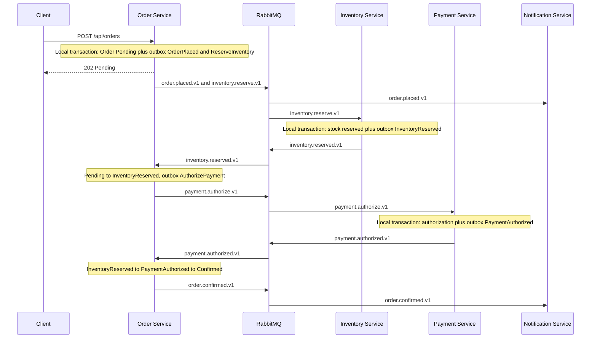
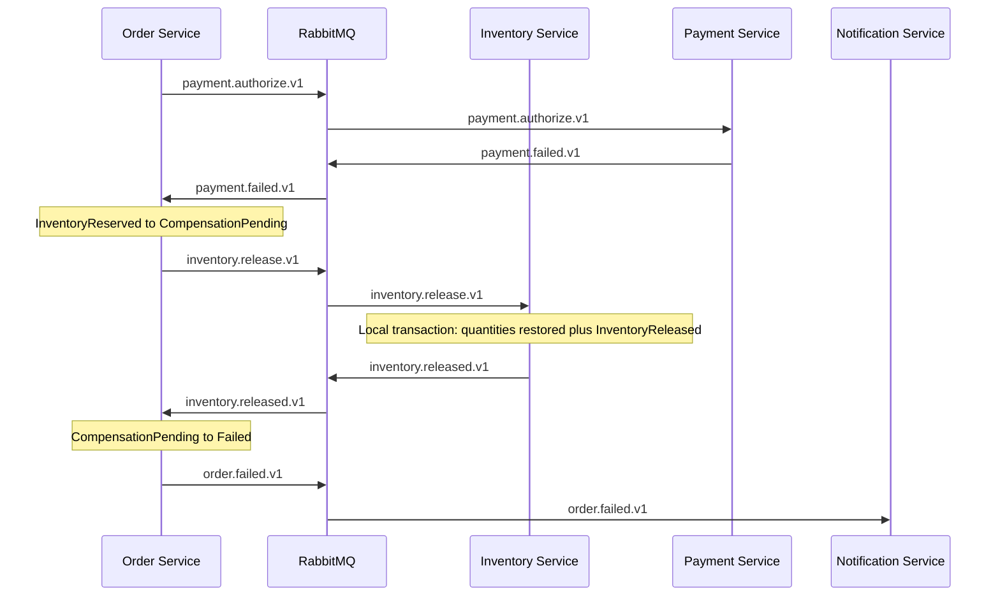

# Saga workflow

The Order Service is the orchestrator. Inventory and Payment do not call each other. They perform one local transaction and publish a result. Notification listens to facts. It does not participate in the decision.

This is orchestration, not choreography. Inventory does not subscribe to `order.placed.v1`. If it did, a second consumer could reserve stock as well as the explicit reserve command.

## Success

`PaymentAuthorized` is stored in `OrderTransitions` in the same transaction that reaches `Confirmed`. A reader of the order row normally sees `Confirmed`. The history shows the authorization step.

## Payment failure and compensation

The order is not `Failed` while compensation is still outstanding. `Failed` means the reservation was released, or stock was never reserved.

If release cannot be completed, the status becomes `CompensationFailed` and `order.compensation-failed.v1` is published. The reservation stays active. A later `inventory.released.v1` can still move that order to `Failed` after someone fixes the stock movement. Until then the order is visibly stuck.

## Inventory rejection

If nothing was reserved, there is nothing to undo. `Pending` becomes `Failed` and notification receives `order.failed.v1`.

## Legal transitions

| From | To | Trigger |
| --- | --- | --- |
| Pending | InventoryReserved | Inventory reserved |
| Pending | Failed | Reservation rejected |
| InventoryReserved | PaymentAuthorized | Payment authorized |
| PaymentAuthorized | Confirmed | Same handler, immediately after authorization |
| InventoryReserved | CompensationPending | Payment failed |
| CompensationPending | Failed | Inventory released |
| CompensationPending | CompensationFailed | Release failed |
| CompensationFailed | Failed | A later successful release |

Any other jump is ignored or rejected. `Pending` to `Confirmed` is not legal. A payment result that arrives before inventory is recorded does not confirm the order.

## Duplicates, retries, and late messages

- The same event id is stored in the consumer inbox. The second delivery does not run the business change.
- The workflow also refuses to repeat a command when the status shows the step already happened. A duplicate `InventoryReserved` does not send a second `AuthorizePayment`.
- A `PaymentAuthorized` message that arrives while the order is still `Pending` is stored as an ignored late event. The status stays `Pending`.
- An `InventoryReserved` message after `Failed` does not revive the order.

RabbitMQ does not promise global order once retries and multiple consumers exist. The saga does not assume the next message is the next logical step. It looks at the persisted status.

## What compensation does not do

Releasing a reservation puts quantity back. It does not undo a captured card charge, a shipped parcel, or an email the customer already read. This payment implementation only simulates authorization, and it does not call a bank.

Compensation can fail. `SKU-RELEASE-FAIL` is a seeded product whose release returns a failure on purpose so the `CompensationFailed` path can be seen. A real release failure needs a person: the stock row and the order status will disagree until someone repairs them. Do not write a loop that pretends every real-world action has a perfect inverse.

## State lives in SQL Server

The workflow does not keep the current step in memory. Restarting the Order Service continues from `Orders.Status`, the transition table, and unpublished outbox rows.
